# 다윗 가문 가계도 (그림)

GitHub가 자동으로 렌더링하는 Mermaid 다이어그램입니다. 코드로 보인다면 GitHub에서 `david-family-tree.md` 파일을 열고 있으면 자동으로 그림이 표시됩니다.

```mermaid
graph TD
    JESSE["이세<br/>(대상 2:13-17)"]

    JESSE --> ELIAB["엘리압<br/>장자 · 삼상 16:6"]
    JESSE --> ABINADAB["아비나답"]
    JESSE --> SHIMEA["시므아(삼마)"]
    JESSE --> NETHANEL["느다넬"]
    JESSE --> RADDAI["랏대"]
    JESSE --> OZEM["오셈"]
    JESSE --> DAVID["다윗<br/>이스라엘 왕"]
    JESSE --> ZERUIAH["스루야<br/>다윗의 누이"]
    JESSE --> ABIGAIL_S["아비가일<br/>다윗의 누이"]

    ZERUIAH --> ABISHAI["아비새<br/>다윗의 대표 용사"]
    ZERUIAH --> JOAB["요압<br/>군대장관 · 왕상 2장에서 처형"]
    ZERUIAH --> ASAHEL["아사헬<br/>아브넬에게 피살 (삼하 2:18-23)"]
    ABIGAIL_S --> AMASA["아마샤<br/>압살롬의 장관 → 귀순 → 요압에게 피살"]

    DAVID --> HEBRON["헤브론에서 얻은 아들들<br/>(대상 3:1-4)"]
    HEBRON --> AMNON["암논<br/>아히노암 소생 · 압살롬에게 피살"]
    HEBRON --> DANIEL["다니엘<br/>아비가일 소생"]
    HEBRON --> ABSALOM["압살롬<br/>마아가 소생 · 반란 (삼하 15-18장)"]
    HEBRON --> ADONIJAH["아도니야<br/>학깃 소생 · 왕위 다툼 (왕상 1-2장)"]
    HEBRON --> SHEPHATIAH["스바댜<br/>아비달 소생"]
    HEBRON --> ITHREAM["이드로암<br/>에글라 소생"]

    DAVID --> JERUSALEM["예루살렘에서 얻은 아들들<br/>(대상 3:5-9)"]
    JERUSALEM --> SHIMEUA["스마 · 소밥<br/>밧세바 소생"]
    JERUSALEM --> NATHAN["나단<br/>눅 3:31 계열"]
    JERUSALEM --> SOLOMON["솔로몬<br/>마 1:6 계열 · 왕위 계승"]
    JERUSALEM --> OTHERS["이발, 엘리사마, 엘리벨렛, 노가,<br/>네벡, 야비야, 엘리사마, 엘리아다, 엘리벨렛<br/>(기타 소생 15인 중 9인, 대상 3:6-8)"]

    DAVID --> TAMAR["다말 (딸)<br/>마아가 소생 · 압살롬의 친누이 (삼하 13:1)"]

    style DAVID fill:#fffbeb,stroke:#f59e0b,stroke-width:3px
    style ZERUIAH fill:#faf5ff,stroke:#a855f7
    style ABIGAIL_S fill:#faf5ff,stroke:#a855f7
    style TAMAR fill:#faf5ff,stroke:#a855f7
    style JOAB fill:#eff6ff,stroke:#3b82f6
    style ABISHAI fill:#eff6ff,stroke:#3b82f6
    style NATHAN fill:#eff6ff,stroke:#3b82f6
    style SOLOMON fill:#eff6ff,stroke:#3b82f6
    style AMNON fill:#fef2f2,stroke:#ef4444
    style ABSALOM fill:#fef2f2,stroke:#ef4444
    style ADONIJAH fill:#fef2f2,stroke:#ef4444
    style ASAHEL fill:#fef2f2,stroke:#ef4444
    style AMASA fill:#fef2f2,stroke:#ef4444
    style HEBRON fill:#f1f5f9,stroke:#94a3b8,stroke-dasharray:4
    style JERUSALEM fill:#f1f5f9,stroke:#94a3b8,stroke-dasharray:4
```

## 색상 범례

| 색 | 의미 |
|---|---|
| 노랑 (다윗) | 다윗 가문의 중심 인물 |
| 파랑 | 핵심 인물 (요압, 아비새, 나단, 솔로몬) |
| 빨강 | 비극적 결말 (암논, 압살롬, 아도니야, 아사헬, 아마샤) |
| 보라 | 다윗의 누이와 딸 (스루야, 아비가일, 다말) |
| 회색 (점선) | 태생지별 묶음 (헤브론 / 예루살렘) |

## 함께 보기

- 표 정리: [david-genealogy.md](david-genealogy.md)
- 역대상 2장 '아버지' 표현 정리: [1chronicles-2-fathers.md](1chronicles-2-fathers.md)
- HTML 버전: `david-family-tree.html`은 GitHub 내부에서 실행되지 않으므로, [htmlpreview 서비스](https://htmlpreview.github.io/?https://github.com/happy1ch/music/blob/main/bible/david-family-tree.html)를 통해 볼 수 있습니다.
